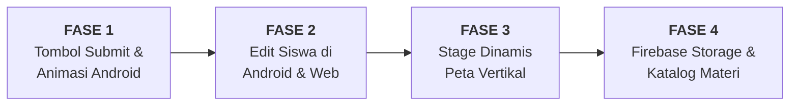

# 📋 Rencana Implementasi Terpadu Proyek SiEja
## Pembaruan Rencana Berdasarkan Catatan Teknis, Arsitektur, Keamanan, dan Tata Kelola Data

---

## 📌 1. Prinsip Utama & Batasan Implementasi

Sesuai instruksi dan evaluasi teknis, pengerjaan proyek mengikuti prinsip-prinsip berikut:
1. **Pemisahan Proyek (Strict Workspace Separation):**
   * Aplikasi Mobile Siswa & Guru Android berada di direktori `SiEja/` (Flutter/Dart).
   * Website Dashboard Guru berada di direktori `Web/SiEja_Web_2.0/` (Next.js/TypeScript).
   * Kedua proyek tetap berada pada repositori/folder terpisah dan menggunakan konfigurasi Firebase project yang sama (`sieja-app`). Tidak ada penggabungan proyek, pembuatan ulang website dari nol, atau perubahan konfigurasi dev/build yang sudah berjalan stabil.
2. **Integritas & Zero-Breaking Change:**
   * Fitur yang sudah berjalan (autentikasi siswa via PIN SHA-256, login guru email/password, 7 tipe mini-game, mode offline, sistem draf anti-cheat) tidak boleh dirusak atau diubah perilakunya secara regresif.
3. **Status Saat Ini:**
   * **Tidak ada kode, data Firestore, konfigurasi Firebase, atau Security Rules yang diubah pada tahap perencanaan ini**. Tidak ada skrip migrasi yang dijalankan sebelum rencana disetujui.

---

## 🔒 2. Arsitektur Keamanan Firebase & Manajemen Hak Akses

### 2.1 Verifikasi Otoritas Guru yang Sah (*Role Verification*)
* **Masalah pada Rancangan Lama:** Menganggap seluruh pengguna dengan `request.auth != null` otomatis sebagai guru adalah celah keamanan (jika di kemudian hari ada registrasi publik, auth anonim, atau user lain).
* **Rancangan Pengamanan Terverifikasi:**
  * Otoritas guru diverifikasi melalui keberadaan dokumen identitas guru terdaftar pada koleksi Firestore `guru/{uid}` atau token klaim khusus guru (`request.auth.token.role == 'guru'`).
  * Aturan Helper di Firestore Rules:
    ```javascript
    function isAuthorizedTeacher() {
      return request.auth != null && (
        exists(/databases/$(database)/documents/guru/$(request.auth.uid)) ||
        request.auth.token.email.matches('.*@sieja\\.com$')
      );
    }
    ```
  * **Pemeriksaan Dampak:** Sebelum rules ini diaktifkan di Firebase Console, pastikan UID akun guru yang saat ini digunakan di Android dan Web telah tercatat di koleksi `guru` atau menggunakan email domain `@sieja.com` agar tidak memutus sesi login guru yang sudah berjalan.

### 2.2 Kebijakan Firestore Rules (Target Desain)
* `siswa/{studentId}`:
  * Read: Siswa dapat membaca dokumennya sendiri (`get`), Guru dapat membaca dan menampilkan daftar seluruh siswa (`list`).
  * Create & Delete: Hanya guru yang berwenang (`isAuthorizedTeacher()`).
  * Update: 
    * Guru yang berwenang dapat mengedit profil (`namaLengkap`, `username`, `pin`, `usia`, `jenisKelamin`, `updatedAt`).
    * Siswa tanpa Firebase Auth **hanya** diizinkan memperbarui field `progress` miliknya sendiri tanpa menyentuh field identitas.
* `login_siswa/{credentialKey}`:
  * Get: Terbuka untuk umum/siswa (karena pencarian akun siswa menggunakan hash SHA-256 sebagai document ID).
  * List: **Dilarang keras** (`allow list: if false;`) untuk mencegah pencurian direktori kredensial seluruh murid.
  * Write (Create, Update, Delete): Hanya guru yang berwenang (`isAuthorizedTeacher()`).
* `stages/{stageId}`:
  * Read: Terbuka untuk siswa dan guru.
  * Write: Hanya guru yang berwenang (`isAuthorizedTeacher()`).
* `katalog/{catalogId}`:
  * Read: Terbuka untuk siswa dan guru.
  * Write: Hanya guru yang berwenang (`isAuthorizedTeacher()`).
* `soal/{questionId}`:
  * Read: Terbuka untuk siswa (soal aktif) dan guru (seluruh soal).
  * Write: Hanya guru yang berwenang (`isAuthorizedTeacher()`).

### 2.3 Kebijakan Firebase Storage Rules
* Path `katalog/images/{fileName}` dan `katalog/audio/{fileName}`:
  * Read: `allow read: if true;` (Materi dapat diunduh/distream oleh aplikasi siswa dan website).
  * Write/Delete: `allow write: if isAuthorizedTeacher() && request.resource.size < 5 * 1024 * 1024;` (Hanya guru, dengan batasan ukuran file maksimal 5 MB untuk mencegah penyalahgunaan kuota storage).

---

## 🔑 3. Konsistensi Sistem Login Siswa (Android & Website)

### 3.1 Formula Hash Kredensial Deterministik
Kredensial pencarian akun login siswa di kedua platform menggunakan formula string yang identik dan deterministik:
$$\text{credentialKey} = \text{hex}(\text{sha256}(\text{lowercase}(\text{trim}(\text{username})) + \text{":"} + \text{pin}))$$

Contoh: Username `Budi` dan PIN `001` menghasilkan string normalisasi `budi:001` $\rightarrow$ Digest SHA-256 $\rightarrow$ Document ID pada koleksi `login_siswa`.

### 3.2 Tata Cara Pembuatan & Pengeditan Siswa
Setiap operasi penambahan atau pengubahan data siswa pada Android maupun Website **wajib** menggunakan transaksi atomik (`writeBatch`):
1. **Penambahan Siswa Baru:**
   * Periksa keunikan username (case-insensitive) pada koleksi `siswa`.
   * Alokasikan PIN otomatis terkecil yang belum digunakan (*Lowest Unassigned Integer*).
   * Dalam 1 batch Firestore:
     * Tulis dokumen `siswa/{studentId}`.
     * Tulis dokumen `login_siswa/{credentialKey}` berisi `{ siswaId, username, createdAt }`.
2. **Pengeditan Data Siswa:**
   * Jika field yang diubah **hanya** `namaLengkap`, `usia`, atau `jenisKelamin`:
     * Cukup update dokumen `siswa/{studentId}`. Dokumen `login_siswa` tidak berubah.
   * Jika `username` atau `pin` **berubah**:
     * Periksa keunikan username baru jika username diubah.
     * Hitung hash lama $\text{credentialKey}_{\text{lama}}$ dan hash baru $\text{credentialKey}_{\text{baru}}$.
     * Dalam 1 batch atomik:
       * Update dokumen `siswa/{studentId}` dengan data baru dan field `updatedAt`.
       * Hapus dokumen lama `login_siswa/{credentialKey_lama}`.
       * Buat dokumen baru `login_siswa/{credentialKey_baru}` berisi referensi `siswaId`.
   * **Jaminan Keamanan:** Siswa lama yang tidak diedit tidak terpengaruh sama sekali. Siswa yang diedit langsung dapat login seketika dengan kredensial barunya.

---

## 🗺️ 4. Rancangan Arsitektur Stage Dinamis

### 4.1 Pemisahan Konfigurasi Global Guru vs Progres Siswa
* **Kelemahan Model Lama:** Status buka/kunci guru sebelumnya dituliskan langsung ke setiap dokumen siswa (`progress.stageX.status`), yang tidak efisien dan mencampuradukkan izin kelas dengan capaian individu.
* **Pemisahan Entitas Baru:**
  1. **Konfigurasi Stage Global (`stages/{stageId}`):**
     * Menyimpan properti stage: nomor, nama, deskripsi materi, rentang huruf, nomor urut (`order`), dan status izin guru (`isOpen: boolean` / `isUnlockedByTeacher: boolean`).
     * Dikelola oleh guru melalui website atau Android.
  2. **Progres Individu Siswa (`siswa/{studentId}/progress.{stageId}`):**
     * Menyimpan data belajar siswa: `skor` (0–100), `status` (`'completed'` jika sudah selesai, `'unlocked'` jika sedang berjalan, `'locked'` jika belum pernah dimulai), dan `updatedAt`.

### 4.2 Aturan Pembukaan Stage (*Dual-Condition Unlock Rule*)
Untuk membuka dan memainkan Stage $N$, sistem mengevaluasi aturan deterministik berikut:
* **Stage 1 (Aturan Khusus):**
  * Selalu berstatus **Terbuka secara Bawaan (*Default Unlocked*)** tanpa syarat kelulusan stage lain.
* **Stage $N$ (di mana $N > 1$):**
  * Siswa diizinkan masuk dan bermain jika dan hanya jika memenuhi **dua syarat sekaligus**:
    $$\text{Dapat Bermain (Stage } N) \iff (\text{Stage } N \text{ Dibuka oleh Guru}) \land (\text{Siswa Selesai Stage } N-1)$$
  * Jika guru belum membuka: Muncul pop-up *"Stage Terkunci! Tunggu gurumu untuk membuka stage ini ya!"*.
  * Jika stage sebelumnya belum tuntas: Muncul pop-up *"Stage $N-1$ Belum Selesai! Kamu harus menyelesaikan Stage $N-1$ dulu ya!"*.

### 4.3 Tampilan Peta Android yang Dapat Digulir Vertikal (*Vertical Scrollable Map*)
* **Desain UI/UX:**
  * Background peta diperluas menggunakan `SingleChildScrollView` atau `ListView.builder` vertikal yang halus (*smooth physics*).
  * Stage 1 s/d 6 tetap menempati layout jalur awal.
  * Setiap stage baru yang ditambahkan guru dari website akan muncul secara dinamis di **urutan paling atas/akhir** dari jalur peta dengan indikator nomor stage, nama lokasi, bintang capaian, dan ikon gembok jika terkunci.
  * **Adapter Ikon Stage:** Menggunakan asset lokal `stage_locked_1`..`6` untuk stage bawaan, dan template badge stage vektor adaptif berbalut nomor stage untuk Stage 7 ke atas.

### 4.4 Kompatibilitas Komposisi Soal & Dashboard
* Di [`stage_question_composer.dart`](file:///e:/Skripsi/projectskripsi/SiEja/lib/services/stage_question_composer.dart): Jika stage $> 6$ belum memiliki template soal lokal `_stageKata`, composer secara otomatis mengambil soal aktif dari Firestore koleksi `soal` untuk stage tersebut. Jika jumlah soal Firestore kurang dari 10, sistem melengkapinya dengan bank soal materi alfabet umum sehingga aplikasi tidak pernah kekurangan 10 soal.

---

## 📦 5. Manajemen Katalog Materi & Firebase Storage

### 5.1 Fallback Offline Asset Bawaan (A–Z)
* 26 materi alfabet lokal (`assets/images/kata/` dan `assets/audio/`) **100% dipertahankan** dalam bundel APK aplikasi.
* Saat aplikasi berada dalam mode luring (*offline*), game tetap dapat berjalan sempurna menggunakan asset lokal.

### 5.2 Alur Upload & Manajemen di Website
1. **Validasi File di Sisi Klien:**
   * Gambar: MIME `image/png`, `image/jpeg`, `image/webp`. Maksimal 2 MB. Dimensi rasio persegi atau mendekati 1:1.
   * Audio Huruf & Kata: MIME `audio/mpeg`, `audio/mp3`, `audio/wav`, `audio/m4a`. Maksimal 5 MB per berkas.
2. **Penanganan Kegagalan Unggah (*Upload Failure & Rollback*):**
   * Upload file gambar dan audio ke Firebase Storage terlebih dahulu.
   * Jika salah satu file gagal diunggah, proses dibatalkan dan file yang terlanjur terunggah otomatis dihapus (*cleanup rollback*).
   * URL unduhan publik dan path Storage disimpan ke dokumen Firestore `katalog/{id}`.
3. **Proteksi Penghapusan Materi Terpakai (*Referential Integrity*):**
   * Sebelum dokumen katalog dan filenya di Storage dihapus oleh guru, sistem mengecek koleksi `soal` apakah materi tersebut (`huruf` dan `kata`) sedang digunakan oleh soal yang berstatus `isActive == true`.
   * Jika sedang digunakan, sistem **menolak penghapusan** dan menampilkan dialog peringatan: *"Materi tidak dapat dihapus karena masih digunakan pada soal aktif di Stage X"*.

---

## 🎯 6. Desain Tombol Submit yang Aman & Idempoten

### 6.1 Pemisahan State Jawaban
Di [`stage_screen.dart`](file:///e:/Skripsi/projectskripsi/SiEja/lib/screens/student/stage_screen.dart), alur pemilihan dan penilaian dipisahkan menjadi dua tahap:
1. **Tahap Pemilihan Tentatif:**
   * Siswa memilih jawaban pada opsi (pilihan ganda, gambar, susun abjad, dsb.).
   * Opsi yang disentuh hanya mengisi state `_tentativeAnswer` dan menampilkan highlight seleksi.
   * Siswa bebas mengubah pilihan atau membatalkan pilihan sesuka hati tanpa konsekuensi nilai.
2. **Tahap Konfirmasi & Penilaian (Submit):**
   * Tombol Submit (`AppImages.btnCheckNormal`) ditampilkan di bawah area permainan.
   * Tombol berada dalam kondisi disabled/redup hingga jawaban tentatif terisi valid.
   * Tombol yang sudah ada di [`spell_word_screen.dart`](file:///e:/Skripsi/projectskripsi/SiEja/lib/screens/student/spell_word_screen.dart) tetap dipertahankan.

### 6.2 Proteksi Idempotensi (*Anti Double-Tap Lock*)
Untuk mencegah penilaian ganda, suara feedback bertumpuk, atau lompatan soal ganda saat tombol ditekan berulang kali secara cepat:
```dart
void _handleSubmitAnswer() {
  // Proteksi Idempotensi: tolak eksekusi jika sudah diproses atau belum memilih
  if (_isSubmitting || _answered || _tentativeAnswer == null) return;

  setState(() {
    _isSubmitting = true; // Kunci segera untuk mencegah ketukan kedua
    _canAnswer = false;
  });

  // Eksekusi penilaian, penambahan skor, audio feedback, dan transisi soal
  _checkAnswer(_tentativeAnswer);
}
```

---

## 🚀 7. Rencana Kerja Detail per Fase Implementasi



---

### 🔹 FASE 1: Tombol Submit dan Animasi Ringan pada Android

#### A. Berkas yang Diubah:
* **Proyek Android (`SiEja`):**
  * [`lib/screens/student/stage_screen.dart`](file:///e:/Skripsi/projectskripsi/SiEja/lib/screens/student/stage_screen.dart):
    * Tambahkan state `_tentativeAnswer`, `_isSubmitting`, dan flag ketersediaan tombol submit.
    * Refaktor 7 mini-game agar tap pilihan hanya mencatat jawaban tentatif.
    * Pasang widget `AssetButton` Submit (`btnCheckNormal`/`btnCheckPressed`) dengan proteksi idempoten.
    * Pasang `AnimatedSwitcher` untuk transisi halus antar-soal.
  * [`lib/screens/student/student_dashboard_screen.dart`](file:///e:/Skripsi/projectskripsi/SiEja/lib/screens/student/student_dashboard_screen.dart):
    * Tambahkan staggered fade & slide animation saat membuka dashboard.
    * Tambahkan idle floating animation lembut pada avatar karakter Eja/Eva.
  * [`lib/screens/student/spell_word_screen.dart`](file:///e:/Skripsi/projectskripsi/SiEja/lib/screens/student/spell_word_screen.dart):
    * Tambahkan proteksi lock `_isSubmitting` pada tombol periksa yang sudah ada.
    * Tambahkan animasi scale/pop saat huruf tersusun ke slot.
  * [`lib/screens/student/spell_guided_screen.dart`](file:///e:/Skripsi/projectskripsi/SiEja/lib/screens/student/spell_guided_screen.dart):
    * Haluskan efek transisi huruf dan selebrasi selesai mengeja.
* **Proyek Website (`Web/SiEja_Web_2.0`):**
  * *Tidak ada berkas yang diubah pada fase ini.*

#### B. Dampak terhadap Firebase & Data Lama:
* **Nol dampak.** Fase ini murni penyempurnaan UI/UX di sisi client Android. Struktur koleksi Firestore dan data siswa yang sudah ada tidak tersentuh sama sekali.

#### C. Risiko Regresi & Mitigasi:
* *Risiko:* Timer intro audio bertabrakan dengan tombol submit, atau tombol submit bisa ditekan saat intro masih berputar.
* *Mitigasi:* Tombol Submit wajib di-disable selama `_canAnswer == false` (saat instruksi audio sedang diputar).

#### D. Kriteria Keberhasilan & Pengujian:
1. Pada seluruh 7 tipe mini-game, memilih jawaban tidak langsung mengurangi/menambah skor.
2. Siswa dapat mengganti pilihan jawaban berkali-kali sebelum menekan Submit.
3. Tombol Submit tidak dapat ditekan jika belum ada pilihan jawaban yang dipilih.
4. Mengetuk tombol Submit secara beruntun (*spamming tap*) terbukti hanya memicu penilaian satu kali.
5. Animasi dashboard dan arena game berjalan mulus pada 60 fps tanpa lag pada emulator/perangkat uji.

---

### 🔹 FASE 2: Edit Data Siswa pada Android dan Website

#### A. Berkas yang Diubah:
* **Proyek Android (`SiEja`):**
  * [`lib/services/firebase_service.dart`](file:///e:/Skripsi/projectskripsi/SiEja/lib/services/firebase_service.dart):
    * Buat method `updateSiswa({required String siswaId, ...})` dengan transaksi atomik `writeBatch` untuk memperbarui dokumen `siswa` dan sinkronisasi `login_siswa`.
  * [`lib/screens/teacher/student_list_screen.dart`](file:///e:/Skripsi/projectskripsi/SiEja/lib/screens/teacher/student_list_screen.dart):
    * Tambahkan tombol "Edit Siswa" pada pop-up detail siswa [`_showDetailSiswaDialog`](file:///e:/Skripsi/projectskripsi/SiEja/lib/screens/teacher/student_list_screen.dart#L550).
    * Buat dialog formulir `_showEditSiswaDialog()` dengan validasi nama, username unik, usia, dan jenis kelamin.
* **Proyek Website (`Web/SiEja_Web_2.0`):**
  * [`services/student-service.ts`](file:///e:/Skripsi/projectskripsi/Web/SiEja_Web_2.0/services/student-service.ts):
    * Buat method `updateStudent()` dan perbaiki `createStudent()` agar keduanya menulis data atomik ke koleksi `login_siswa` menggunakan hash SHA-256 yang identik dengan Android.
  * [`components/students/student-page.tsx`](file:///e:/Skripsi/projectskripsi/Web/SiEja_Web_2.0/components/students/student-page.tsx):
    * Tambahkan tombol Edit (ikon pensil) di tabel daftar siswa dan modal dialog formulir Edit Siswa.
  * [`lib/domain/business-rules.ts`](file:///e:/Skripsi/projectskripsi/Web/SiEja_Web_2.0/lib/domain/business-rules.ts):
    * Tambahkan fungsi helper kalkulasi credential hash SHA-256 dan validasi data edit siswa.

#### B. Dampak terhadap Firebase & Data Lama:
* Struktur dokumen `siswa` tetap sama, hanya menambahkan field opsional `updatedAt`.
* Memperbaiki kekurangan website sebelumnya di mana siswa yang dibuat lewat website tidak memiliki data di `login_siswa`.
* Data siswa lama yang tidak diedit tetap berjalan normal 100%.

#### C. Risiko Regresi & Mitigasi:
* *Risiko:* Perubahan username atau PIN membuat siswa gagal login karena inkonsistensi hash.
* *Mitigasi:* Seluruh update identitas login dilakukan dalam 1 `writeBatch` (hapus dokumen lama di `login_siswa` dan set dokumen baru).

#### D. Kriteria Keberhasilan & Pengujian:
1. Guru dapat mengedit nama, usia, jenis kelamin, username, dan PIN siswa dari website maupun Android.
2. Siswa yang diedit username atau PIN-nya berhasil login seketika di Android menggunakan kredensial baru.
3. Kredensial lama terbukti tidak bisa digunakan lagi untuk login.
4. Siswa lain yang tidak diedit tetap bisa login normal tanpa kendala.
5. Username duplikat ditolak dengan pesan kesalahan yang ramah pengguna.

---

### 🔹 FASE 3: Pengelolaan Stage Dinamis

#### A. Berkas yang Diubah:
* **Proyek Android (`SiEja`):**
  * [`lib/screens/student/stage_map_screen.dart`](file:///e:/Skripsi/projectskripsi/SiEja/lib/screens/student/stage_map_screen.dart):
    * Ubah layout peta menjadi vertikal scrollable (*Vertical Scrollable Map*).
    * Render daftar stage secara dinamis dari Firestore (dengan fallback lokal 6 stage jika offline).
    * Implementasi adapter ikon untuk Stage 7 ke atas.
    * Terapkan aturan pembukaan: Stage $N$ hanya bisa dimainkan jika dibuka guru DAN Stage $N-1$ sudah `'completed'` (Stage 1 selalu terbuka).
  * [`lib/screens/teacher/unlock_level_screen.dart`](file:///e:/Skripsi/projectskripsi/SiEja/lib/screens/teacher/unlock_level_screen.dart):
    * Daftar kelola level mengambil seluruh stage aktif secara dinamis.
    * Mengubah status buka/kunci guru pada dokumen stage global.
  * [`lib/services/progress_service.dart`](file:///e:/Skripsi/projectskripsi/SiEja/lib/services/progress_service.dart):
    * Sinkronisasi progres lokal mendukung key stage dinamis tanpa batasan angka 6.
  * [`lib/services/stage_question_composer.dart`](file:///e:/Skripsi/projectskripsi/SiEja/lib/services/stage_question_composer.dart):
    * Sediakan fallback komposisi soal dari koleksi `soal` untuk stage tambahan.
* **Proyek Website (`Web/SiEja_Web_2.0`):**
  * [`services/stage-service.ts`](file:///e:/Skripsi/projectskripsi/Web/SiEja_Web_2.0/services/stage-service.ts):
    * Tambahkan fungsi `createStage()` dan `getStages()`.
    * Pisahkan fungsi buka/kunci stage agar memperbarui dokumen konfigurasi `stages/{stageId}`.
  * [`components/stages/stage-page.tsx`](file:///e:/Skripsi/projectskripsi/Web/SiEja_Web_2.0/components/stages/stage-page.tsx):
    * Tambahkan tombol dan modal "Tambah Stage Baru".
    * Tampilkan kartu stage secara dinamis dari koleksi Firestore `stages`.
  * [`components/questions/question-form-page.tsx`](file:///e:/Skripsi/projectskripsi/Web/SiEja_Web_2.0/components/questions/question-form-page.tsx):
    * Dropdown pilihan stage mengambil daftar stage dinamis dari Firestore.
  * [`types/sieja.ts`](file:///e:/Skripsi/projectskripsi/Web/SiEja_Web_2.0/types/sieja.ts):
    * Deklarasi `StageId` diubah menjadi tipe string dinamis kompatibel.

#### B. Dampak terhadap Firebase & Data Lama:
* Membuat koleksi baru `stages` di Firestore.
* Data progres `stage1`..`stage6` pada seluruh siswa lama tetap utuh dan terbaca normal.
* Firestore Security Rules disesuaikan agar `validStageId` menerima format `^stage[0-9]+$`.

#### C. Risiko Regresi & Mitigasi:
* *Risiko:* Stage 7+ tidak memiliki asset ilustrasi di `assets/images/stage/` dan menyebabkan aplikasi crash karena missing asset.
* *Mitigasi:* Gunakan pattern fallback ikon stage: periksa keberadaan asset nomor, jika tidak ada fallback ke template badge piala bawaan dengan overlay nomor stage.

#### D. Kriteria Keberhasilan & Pengujian:
1. Guru berhasil menambahkan Stage 7 melalui website, dan stage baru muncul di urutan terakhir.
2. Peta di Android dapat digulir ke atas untuk melihat Stage 7.
3. Stage 7 berstatus default terkunci dan tidak bisa dimainkan sebelum dibuka guru.
4. Meskipun Stage 7 sudah dibuka guru, siswa yang belum menyelesaikan Stage 6 tetap dilarang masuk ke Stage 7 dengan dialog penjelasan yang tepat.
5. Siswa yang sudah menyelesaikan Stage 6 dan gurunya telah membuka Stage 7 dapat masuk dan memainkan permainan dengan normal.
6. Stage 1 tetap dapat dimainkan langsung tanpa syarat.

---

### 🔹 FASE 4: Katalog Materi & Firebase Storage

#### A. Berkas yang Diubah:
* **Proyek Android (`SiEja`):**
  * [`pubspec.yaml`](file:///e:/Skripsi/projectskripsi/SiEja/pubspec.yaml): Tambahkan `firebase_storage: ^12.4.4` dan `cached_network_image: ^3.3.1`.
  * [`lib/core/app_constants.dart`](file:///e:/Skripsi/projectskripsi/SiEja/lib/core/app_constants.dart):
    * Buat media resolver yang mengutamakan cache/cloud URL untuk materi baru, dengan fallback instan ke asset lokal untuk 26 huruf bawaan.
  * [`lib/services/question_service.dart`](file:///e:/Skripsi/projectskripsi/SiEja/lib/services/question_service.dart):
    * Sesuaikan `hasValidAsset` agar mendukung validasi materi dinamis dari katalog Firestore.
  * [`lib/screens/student/stage_screen.dart`](file:///e:/Skripsi/projectskripsi/SiEja/lib/screens/student/stage_screen.dart):
    * Render gambar menggunakan `CachedNetworkImage` (jika URL cloud) atau `Image.asset` (jika lokal).
    * Putar audio menggunakan `UrlSource(url)` (jika URL cloud) atau `AssetSource(path)` (jika lokal).
* **Proyek Website (`Web/SiEja_Web_2.0`):**
  * [`lib/firebase/client.ts`](file:///e:/Skripsi/projectskripsi/Web/SiEja_Web_2.0/lib/firebase/client.ts): Inisialisasi Firebase Storage Client (`getStorage(app)`).
  * [`services/catalog-service.ts`](file:///e:/Skripsi/projectskripsi/Web/SiEja_Web_2.0/services/) *(File Baru)*:
    * Fungsi unggah media ke Storage, simpan metadata ke Firestore, dan proteksi hapus jika materi berelasi dengan soal aktif.
  * [`components/catalog/`](file:///e:/Skripsi/projectskripsi/Web/SiEja_Web_2.0/components/) *(Modul Baru)*:
    * Halaman Manajemen Katalog: tabel materi, form upload (gambar, audio huruf, audio kata), audio preview player, dan dialog konfirmasi hapus.
  * [`components/questions/question-form-page.tsx`](file:///e:/Skripsi/projectskripsi/Web/SiEja_Web_2.0/components/questions/question-form-page.tsx):
    * Dropdown kata dan huruf terhubung ke koleksi `katalog` Firestore.

#### B. Dampak terhadap Firebase & Data Lama:
* Mengaktifkan Firebase Storage bucket `sieja-app.firebasestorage.app`.
* Membuat koleksi baru `katalog` di Cloud Firestore.
* 26 materi bawaan lama tetap ada dan berfungsi offline.

#### C. Risiko Regresi & Mitigasi:
* *Risiko:* Kuota bandwidth Storage membengkak atau koneksi lambat membuat game macet saat memuat gambar/suara.
* *Mitigasi:*
  * Gunakan `cached_network_image` di Android agar file gambar hanya diunduh satu kali dan disimpan di disk HP.
  * Validasi ukuran upload di web (gambar maks 2 MB, audio maks 5 MB).
  * Batalkan penghapusan materi katalog jika masih dipakai pada soal aktif.

#### D. Kriteria Keberhasilan & Pengujian:
1. Guru berhasil mengunggah gambar, audio huruf, dan audio kata untuk materi baru di website.
2. File tersimpan dengan rapi di Firebase Storage dan metadatanya tercatat di Firestore `katalog`.
3. Guru dapat membuat soal menggunakan materi baru tersebut di website.
4. Aplikasi Android berhasil menampilkan gambar dan memutar audio materi baru secara online.
5. Saat internet dimatikan (mode offline), materi bawaan A–Z tetap dapat dimainkan tanpa error.
6. Percobaan menghapus materi yang sedang dipakai soal aktif berhasil dicegah oleh sistem dengan pesan peringatan yang sesuai.

---

## 📌 8. Status Akhir & Langkah Persetujuan

Rencana implementasi di atas telah diperbarui secara menyeluruh dan mengintegrasikan seluruh catatan teknis:
- [x] Struktur proyek Flutter dan Website dipertahankan terpisah tanpa rewrite.
- [x] Mekanisme login siswa dan sinkronisasi `login_siswa` dirancang konsisten dan atomik.
- [x] Konfigurasi keamanan Firebase dan verifikasi hak akses guru telah dirumuskan tanpa asumsi prematur.
- [x] Stage dinamis dipisahkan antara konfigurasi global guru dan progres siswa, dengan tampilan peta vertikal gulir dan aturan buka/kunci yang kokoh.
- [x] Katalog offline 26 huruf lokal dipertahankan penuh sebagai fallback primer.
- [x] Tombol Submit dirancang aman dengan proteksi idempoten (*anti double-tap*).
- [x] Rincian 4 fase implementasi telah dilengkapi daftar file, dampak data, risiko regresi, dan kriteria pengujian.

> ⚠️ **Sesuai batasan, kode belum diubah.** Mohon berikan persetujuan Anda untuk memulai eksekusi **Fase 1 (Tombol Submit & Animasi Ringan pada Android)**.
