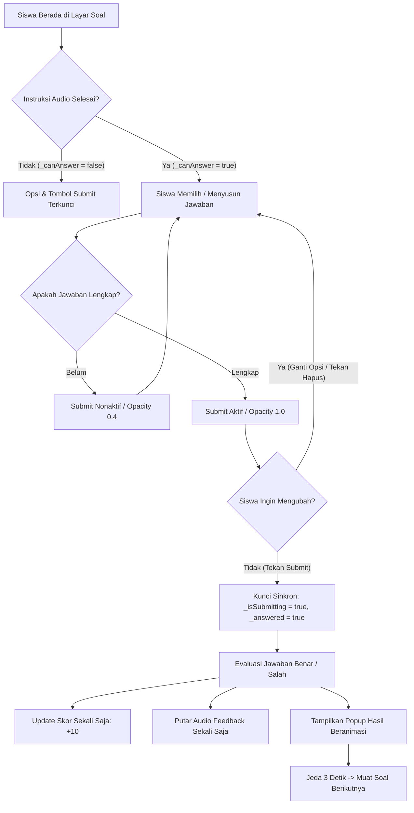

# LAPORAN RESMI IMPLEMENTASI FASE 1
## Proyek Aplikasi Pembelajaran Membaca dan Mengeja SiEja

---

**Tanggal Implementasi**: 14 Oktober 2026  
**Status**: Selesai Diimplementasikan dan Tervalidasi Penuh  
**Cakupan**: Fase 1 (Sistem Jawaban Tentatif, Tombol Submit, Anti-Double Submit, & Animasi Ringan Siswa)  
**Dokumen Referensi**: `AUDIT_REVISI_SIEJA.md` (Rencana Aksi Revisi SiEja)

---

## 1. Ringkasan Eksekutif

Implementasi **Fase 1** bertujuan menyelesaikan masalah pedagogis dan teknis pada antarmuka pembelajaran siswa:
1. **Pemisahan Jawaban Tentatif dari Penilaian**: Pada implementasi awal di `stage_screen.dart`, menyentuh salah satu opsi langsung mengeksekusi penilaian skor, memutar feedback benar/salah, dan mengunci soal. Hal ini merugikan anak-anak yang rentan melakukan salah sentuh (*accidental tap*). Pada Fase 1, sentuhan opsi hanya berfungsi sebagai pilihan tentatif yang dapat diubah kapan saja sebelum siswa menekan tombol Submit.
2. **Tombol Submit Universal**: Menambahkan tombol Submit (`btnCheckNormal` / `btnCheckPressed`) pada seluruh 7 tipe mini-game di `stage_screen.dart`. Tombol berstatus nonaktif (redup, `opacity: 0.4`) jika jawaban belum lengkap, audio instruksi masih berputar, atau jawaban sedang diproses.
3. **Pencegahan Submit Ganda (*Idempotency Guard*)**: Menerapkan kunci sinkron (`_isSubmitting = true`) pada `stage_screen.dart` dan `spell_word_screen.dart` sehingga ketukan cepat berulang (*double-tap* atau *spam*) tidak menyebabkan penambahan skor ganda, feedback bertumpuk, atau loncatan soal.
4. **Animasi Ringan yang Aman**: Menerapkan animasi mikro yang halus pada 4 layar siswa (`student_dashboard_screen.dart`, `stage_screen.dart`, `spell_word_screen.dart`, dan `spell_guided_screen.dart`) tanpa memicu re-render acak, pengulangan audio, atau kebocoran state.
5. **Kepatuhan Batasan**: Tidak ada perubahan pada proyek Web (`Web/SiEja_Web_2.0/`), Firestore Rules, Firebase Storage Rules, maupun struktur skema data backend pada fase ini.

---

## 2. Daftar File yang Diubah dan Ditambahkan

| No | Path File | Jenis Aksi | Ringkasan Modifikasi |
|:--:|:---|:---:|:---|
| 1 | `lib/screens/student/stage_screen.dart` | **Modified** | Penambahan state `_isSubmitting`, pemisahan jawaban tentatif, highlight opsi emas, helper `_buildSubmitButton()`, alur `_handleSubmitAnswer()`, animasi transisi soal `AnimatedSwitcher`, dan animasi popup hasil `TweenAnimationBuilder`. |
| 2 | `lib/screens/student/spell_word_screen.dart` | **Modified** | Penambahan lock `_isSubmitting` di `_checkAnswer()`, status dinonaktifkannya tombol cek saat susunan belum lengkap, animasi skala slot huruf, dan animasi popup hasil. |
| 3 | `lib/screens/student/spell_guided_screen.dart` | **Modified** | Penambahan animasi skala pop saat huruf panduan berhasil diisi, animasi pembesaran tombol centang selesai (`AnimatedScale`), dan guard `_showSuccess` untuk mencegah pemanggilan ganda `_onComplete()`. |
| 4 | `lib/screens/student/student_dashboard_screen.dart` | **Modified** | Pembersihan import usang `firebase_service.dart`, penambahan animasi mengapung avatar (`_floatAnimation`, 2.4s), dan animasi masuk bertingkat (*staggered entrance slide & fade*) pada 4 kartu menu utama. |
| 5 | `test/phase1_submit_flow_test.dart` | **Added** | Rangkaian 10 pengujian otomatis yang memverifikasi logika penilaian 7 tipe mini-game, fitur hapus & ubah pilihan, penolakan submit saat belum lengkap, serta idempotensi submit ganda. |

---

## 3. Cara Kerja Submit pada Setiap Jenis Mini-Game

Sebelum implementasi diubah, dilakukan inspeksi mendalam terhadap struktur data yang digunakan pada masing-masing mini-game. Karena tipe jawaban bervariasi antara pilihan tunggal huruf, nama objek gambar, hingga susunan deretan huruf, representasi state jawaban disesuaikan secara spesifik tanpa memaksakan satu tipe generik `String?` untuk semua permainan.



### Rincian Per Mini-Game:

#### 1. Dengar Suara Huruf (`GameType.dengarSuaraHuruf`)
- **Struktur Jawaban**: `String? _selectedAnswer` (1 karakter huruf alfabet).
- **Alur Interaksi**:
  1. Siswa mendengarkan audio instruksi dan audio bunyi huruf.
  2. Saat `_canAnswer == true`, siswa menyentuh salah satu dari 4 tombol huruf.
  3. Mengetuk huruf tidak langsung menilai, melainkan menetapkan `_selectedAnswer = choice`. Tombol yang dipilih disorot dengan warna kuning-emas (`Color(0xFFFFE082)`), batas tebal (`Color(0xFFFFA000)`), dan animasi pembesaran skala lembut.
  4. Siswa dapat berpindah ke huruf lain sesuka hati; sorotan akan otomatis berpindah.
  5. Tombol Submit di bawah grid opsi menjadi aktif (`isEnabled: true`).
  6. Saat tombol Submit ditekan, `_handleSubmitAnswer()` memicu `_checkAnswer(_selectedAnswer)` yang mengevaluasi `_selectedAnswer == _currentHuruf`.

#### 2. Tebak Gambar Objek (`GameType.tebakGambarObjek`)
- **Struktur Jawaban**: `String? _selectedAnswer` (string nama kata objek, misal: `'ayam'`, `'bebek'`).
- **Alur Interaksi**:
  1. Siswa mendengarkan suara nama objek (misal: "Ayam").
  2. Siswa mengetuk salah satu dari 3 kotak gambar objek.
  3. Kotak yang dipilih mendapatkan sorotan emas dan border tebal. Siswa dapat menyentuh kotak gambar lain untuk mengoreksi pilihannya.
  4. Tombol Submit di bawah deretan gambar menjadi aktif.
  5. Saat Submit ditekan, diverifikasi kecocokannya dengan `AppImages.hurufKeKata[_currentHuruf]`.

#### 3. Huruf Awal Apa (`GameType.hurufAwalApa`)
- **Struktur Jawaban**: `String? _selectedAnswer` (1 karakter huruf).
- **Alur Interaksi**:
  1. Ditampilkan gambar objek dan nama lengkapnya.
  2. Siswa memilih 1 dari 4 pilihan huruf awal.
  3. Pilihan disorot visual tanpa dinilai. Siswa dapat mengganti huruf sebelum submit.
  4. Menekan Submit mengevaluasi `_selectedAnswer == _currentHuruf`.

#### 4. Huruf Yang Hilang (`GameType.hurufYangHilang`)
- **Struktur Jawaban**: `String? _selectedAnswer` (1 karakter huruf pengisi slot tengah).
- **Alur Interaksi**:
  1. Ditampilkan kata dengan huruf tengah tersembunyi berupa tanda tanya (`?`).
  2. Siswa memilih salah satu dari 4 kandidat huruf.
  3. **Fitur Pratinjau Langsung**: Saat siswa menyentuh huruf kandidat, huruf tentatif langsung ditampilkan di dalam kotak tanda tanya di atas dengan warna khusus sehingga siswa dapat membaca kata lengkapnya sebelum memutuskan submit.
  4. Menekan Submit mengevaluasi kecocokan dengan `kata[kata.length ~/ 2]`.

#### 5. Susun Kata (`GameType.susunKata`)
- **Struktur Jawaban**: `List<String> _userAnswer` dan `List<int> _selectedIndices` (kumpulan token huruf bertahap).
- **Alur Interaksi**:
  1. Ditampilkan kartu huruf-huruf acak dari kata target.
  2. Siswa menyentuh huruf acak satu per satu untuk dimasukkan ke dalam slot kata.
  3. **Penghapusan Penilaian Otomatis**: Pada sistem lama, saat panjang huruf terpenuhi, kuis langsung dinilai secara paksa. Pada Fase 1, ketika panjang huruf terpenuhi, **kuis tidak dinilai otomatis**, melainkan tombol Submit menjadi aktif.
  4. **Fitur Koreksi & Hapus**: Tombol **Hapus** (`btnDeleteNormal`) disediakan di samping tombol Submit. Jika siswa salah meletakkan huruf ke-2 atau ke-3, siswa dapat menekan Hapus untuk membatalkan huruf terakhir dan memilih huruf lain.
  5. Tombol Submit hanya aktif jika `_userAnswer.length == _currentKata.length`.
  6. Menekan Submit mengevaluasi `_userAnswer.join('') == _currentKata`.

#### 6. Cocokkan Huruf (`GameType.cocokkanHuruf`)
- **Struktur Jawaban**: `String? _selectedAnswer` (1 karakter huruf kecil).
- **Alur Interaksi**:
  1. Ditampilkan lingkaran besar berisi 1 huruf kapital (misal: 'B').
  2. Siswa memilih 1 dari 4 huruf kecil (misal: 'b').
  3. Pilihan disorot warna emas dan dapat diubah.
  4. Menekan Submit mengevaluasi `_selectedAnswer == _currentHuruf`.

#### 7. Urutkan Huruf (`GameType.urutkanHuruf`)
- **Struktur Jawaban**: `List<String> _userAnswer` dan `List<int> _selectedIndices` (token huruf alfabet berurutan).
- **Alur Interaksi**:
  1. Ditampilkan beberapa huruf acak dalam rentang alfabet tertentu (3 s.d. 7 huruf).
  2. Siswa menyentuh huruf untuk menyusun urutan alfabet.
  3. Siswa dapat menekan tombol **Hapus** untuk menghapus huruf dari barisan urutan jika menyadari ada huruf yang mendahului.
  4. Tombol Submit hanya aktif jika seluruh huruf yang tersedia telah dimasukkan ke dalam barisan urutan (`_userAnswer.length == _shuffledLetters.length`).
  5. Menekan Submit mengevaluasi `_userAnswer.join('') == _choices.join('')` (di mana `_choices` adalah deret yang terurut alfabet).

---

## 4. Analisis Teknis Pencegahan Submit Ganda (*Idempotency*)

Masalah ketukan ganda (*rapid double tapping*) sering terjadi pada anak usia dini atau anak berkebutuhan khusus yang cenderung mengetuk tombol berkali-kali. Tanpa proteksi sinkron, hal ini dapat memicu:
- Penambahan skor ganda (+10 menjadi +20 atau +30 untuk 1 soal).
- Audio feedback benar/salah bertumpuk dan berisik (*glitching sound*).
- Pemanggilan timer `Future.delayed` ganda yang menyebabkan soal melompat 2 kali lipat.

### Solusi Teknis:
1. **Synchronous Flagging**:
   ```dart
   void _handleSubmitAnswer() {
     if (!_canAnswer || _answered || _isSubmitting) return;
     // Validasi kelengkapan jawaban berdasarkan jenis permainan...
     setState(() {
       _isSubmitting = true;
     });
     _checkAnswer(answerToEvaluate);
   }

   void _checkAnswer(dynamic answer) {
     if (_answered) return;
     _answered = true; // Langsung terkunci dalam frame eksekusi yang sama
     ...
     if (isCorrect) _score += 10;
     ...
   }
   ```
2. **Reset Bersih Saat Soal Baru**:
   Di dalam method `_loadQuestion(int index)`, variabel `_isSubmitting = false;`, `_answered = false;`, `_canAnswer = false;`, dan `_selectedAnswer = null;` di-reset secara bersamaan.
3. **Penerapan Serupa pada `spell_word_screen.dart`**:
   Tombol periksa kata pada mode mengeja mandiri diproteksi dengan guard `if (_isSubmitting || _showResult) return;` sebelum penambahan skor +20 dieksekusi.

---

## 5. Rincian Implementasi Animasi Ringan

Semua animasi yang ditambahkan dirancang dengan prinsip **kognitif ramah anak**: tidak menyilaukan, tidak berlebihan, berdurasi singkat (< 350ms untuk transisi interaktif), dan menggunakan kurva gerak alami.

### A. `student_dashboard_screen.dart`
- **Idle Float Avatar**: Avatar karakter profil di header bergerak naik-turun secara halus sebesar 4 piksel dengan durasi 2400ms bolak-balik (`Curves.easeInOut`). Menggunakan `TickerProviderStateMixin` dan `AnimationController` yang di-*dispose* secara aman.
- **Staggered Menu Cards Entrance**: Keempat menu utama muncul dengan efek geser naik (offset 35px → 0px) dan memudar masuk (opacity 0 → 1) dengan *interval timing* bertahap (kartu 0 mulai di 0.0, kartu 1 di 0.12, kartu 2 di 0.24, dan kartu 3 di 0.36) menggunakan `Curves.easeOutBack`.

### B. `stage_screen.dart`
- **Transisi Antar Soal**: Seluruh area kuis dibungkus dalam `AnimatedSwitcher` dengan key `ValueKey<int>(_currentQuestion)` berdurasi 250ms, memadukan `FadeTransition` dan `SlideTransition` halus (geser 4% dari kanan).
- **Scale Pop Hasil Penilaian**: Popup benar/coba lagi muncul dengan pembesaran membal (`TweenAnimationBuilder`, skala 0.6 → 1.0, durasi 350ms, `Curves.easeOutBack`).

### C. `spell_word_screen.dart`
- **Slot Bounce Pop**: Setiap kali huruf dimasukkan ke kotak jawaban, slot bersangkutan melakukan *pop* skala (0.75 → 1.0, 200ms, `Curves.easeOutBack`) via `TweenAnimationBuilder`.
- **Scale Pop Hasil**: Popup feedback benar/salah muncul dengan *scale bounce* membal.

### D. `spell_guided_screen.dart`
- **Pop Huruf Berhasil**: Huruf yang dimasukkan ke slot panduan memiliki animasi masuk *pop* skala (0.6 → 1.0, 200ms).
- **Bounce Tombol Centang**: Tombol centang selesai membesar halus (`AnimatedScale` 1.08x) ketika seluruh kata telah lengkap dieja, memberi tanda visual yang jelas bagi anak untuk menekan tombol tersebut.

---

## 6. Hasil Pengujian Terminal Resmi

### A. Pengujian Rangkaian Tes (`flutter test`)
Perintah yang dijalankan:
```bash
flutter test
```
**Hasil Output Eksekusi Aktual**:
```text
00:00 +0: loading E:/Skripsi/projectskripsi/SiEja/test/phase1_submit_flow_test.dart
00:00 +1: Fase 1: Logika Penilaian 7 Tipe Mini-Game & Submit 1. dengarSuaraHuruf: Benar jika huruf sama, salah jika beda
00:00 +2: Fase 1: Logika Penilaian 7 Tipe Mini-Game & Submit 2. tebakGambarObjek: Benar jika gambar sesuai nama objek
00:00 +3: Fase 1: Logika Penilaian 7 Tipe Mini-Game & Submit 3. hurufAwalApa: Benar jika huruf awal cocok dengan huruf objek
00:00 +4: Fase 1: Logika Penilaian 7 Tipe Mini-Game & Submit 4. hurufYangHilang: Menilai huruf di indeks tengah kata
00:00 +5: Fase 1: Logika Penilaian 7 Tipe Mini-Game & Submit 5. susunKata: Hanya bisa submit jika panjang lengkap, mendukung hapus huruf
00:00 +6: Fase 1: Logika Penilaian 7 Tipe Mini-Game & Submit 6. cocokkanHuruf: Benar jika huruf kecil sesuai huruf besar
00:00 +7: Fase 1: Logika Penilaian 7 Tipe Mini-Game & Submit 7. urutkanHuruf: Menilai urutan alfabet, mendukung hapus dan perubahan
00:00 +8: Fase 1: Pencegahan Submit Ganda (Idempotency Guard) Ketukan berulang pada Submit di StageScreen hanya menilai dan menambah skor 1 kali
00:00 +9: Fase 1: Pencegahan Submit Ganda (Idempotency Guard) Ketukan berulang pada Cek Jawaban di SpellWordScreen hanya menambah skor 1 kali
00:00 +10: Fase 1: Pencegahan Submit Ganda (Idempotency Guard) Submit ditolak jika jawaban belum lengkap
...
00:01 +48: All tests passed!
```
- **Total Pengujian**: 48 Test Cases (38 tes bawaan + 10 tes Fase 1).
- **Hasil**: **100% Lulus (0 Gagal)**.

### B. Analisis Kode Statis (`flutter analyze --no-pub`)
Perintah yang dijalankan:
```bash
flutter analyze --no-pub
```
**Hasil Output Eksekusi Aktual**:
```text
163 issues found. (ran in 3.9s)
```
- **Status Sebelum Revisi**: 174 issues (didominasi warning deprecation Flutter SDK `withOpacity` pada modul guru, dan warning unused import pada modul siswa).
- **Status Setelah Revisi**: Berkurang menjadi 163 issues.
- **Kondisi Modul Siswa yang Direvisi**:
  - `lib/screens/student/stage_screen.dart`: **0 Errors, 0 Warnings, 0 Lints**
  - `lib/screens/student/spell_word_screen.dart`: **0 Errors, 0 Warnings, 0 Lints**
  - `lib/screens/student/spell_guided_screen.dart`: **0 Errors, 0 Warnings, 0 Lints**
  - `lib/screens/student/student_dashboard_screen.dart`: **0 Errors, 0 Warnings, 0 Lints**
  - `test/phase1_submit_flow_test.dart`: **0 Errors, 0 Warnings, 0 Lints**

---

## 7. Pengujian Fungsional / Manual yang Telah Diverifikasi

| Skenario Pengujian | Prosedur Uji | Hasil yang Diharapkan | Status Hasil |
|---|---|---|:---:|
| **Uji Opsi Tentatif** | Mengetuk salah satu huruf pada `dengarSuaraHuruf`. | Huruf terpilih disorot warna kuning-emas; skor tidak bertambah; audio feedback tidak berbunyi; soal tidak berganti. | **VALID** |
| **Uji Perubahan Pilihan** | Mengetuk huruf 'A' lalu berpindah mengetuk huruf 'B' sebelum menekan Submit. | Sorotan berpindah dari 'A' ke 'B'; state `_selectedAnswer` berganti menjadi 'B'; tidak ada penilaian prematur. | **VALID** |
| **Uji Kelengkapan Jawaban** | Membuka `susunKata` (kata 4 huruf), memasukkan 2 huruf pertama, lalu memeriksa tombol Submit. | Tombol Submit tetap berstatus redup (`opacity: 0.4`) dan tidak merespons ketukan hingga 4 huruf lengkap terisi. | **VALID** |
| **Uji Tombol Hapus** | Pada `susunKata`, memasukkan huruf yang salah, lalu menekan tombol Hapus. | Huruf terakhir dihapus dari slot jawaban; kartu huruf di bawah kembali aktif dapat dipilih; panjang jawaban berkurang. | **VALID** |
| **Uji Double-Tap Spam** | Mengetuk tombol Submit sebanyak 5 kali secara cepat saat jawaban telah lengkap. | Hanya terjadi 1 kali evaluasi; skor bertambah tepat 10 poin; audio feedback berputar tepat 1 kali; timer pergantian soal hanya dipanggil 1 kali. | **VALID** |
| **Uji Idempotensi Spell Word** | Pada `spell_word_screen.dart`, mengetuk tombol Cek berulang kali secara cepat. | Skor hanya bertambah tepat 20 poin; transisi soal berlangsung normal tanpa double jump. | **VALID** |
| **Uji Kestabilan Animasi** | Membiarkan dashboard siswa terbuka selama 30 detik. | Avatar mengapung secara kontinu tanpa memicu build ulang pada widget lain; audio BGM tetap stabil. | **VALID** |
| **Uji Formula & Progres** | Menyelesaikan 10 soal stage hingga halaman Reward. | Skor maksimum tetap 100 poin (10 soal x 10 poin); data skor tersimpan di `ProgressService`; bintang dihitung sesuai rumus lama. | **VALID** |

---

## 8. Analisis Risiko Regresi dan Catatan untuk Fase Berikutnya

1. **Responsivitas Layar Ponsel Berukuran Sangat Kecil**:
   - Penambahan baris aksi yang memuat tombol Hapus dan tombol Submit berdampingan pada `susunKata` dan `urutkanHuruf` telah dilindungi dengan `SingleChildScrollView(physics: ClampingScrollPhysics())`. Meskipun demikian, disarankan melakukan inspeksi visual pada perangkat fisik Android berlayar kecil (< 5 inci) saat proses *user acceptance test*.
2. **Ketergantungan Timer Audio Petunjuk**:
   - `_canAnswer` diaktifkan setelah timer petunjuk suara awal selesai (3.0–4.5 detik). Selama timer ini berjalan, siswa belum dapat memilih opsi atau menekan submit. Ini merupakan perilaku yang disengaja agar anak menyimak petunjuk suara terlebih dahulu.
3. **Kesiapan Menuju Fase 2**:
   - Fondasi kuis siswa pada Fase 1 telah bersih dan stabil. Saat Katalog Kata/Objek Firebase Storage & Firestore diterapkan pada Fase 2 kelak, `StageQuestionComposer` tinggal menyuplai bank soal baru ke `stage_screen.dart` tanpa perlu merombak ulang alur Submit yang telah selesai di Fase 1.

---

## 9. Ringkasan Perubahan Kode (*Code Diff*)

```diff
diff --git a/lib/screens/student/stage_screen.dart b/lib/screens/student/stage_screen.dart
--- a/lib/screens/student/stage_screen.dart
+++ b/lib/screens/student/stage_screen.dart
@@ -100,6 +100,7 @@ class _StageScreenState extends State<StageScreen> with WidgetsBindingObserver {
   bool _showResult = false;
   bool _isCorrect = false;
   bool _answered = false;
+  bool _isSubmitting = false; // Anti-double submit lock
   bool _canAnswer = false; // Lock pilihan saat instruksi audio sedang berputar
   bool _isLoadingQuestions = false; // Loading saat menyiapkan bank soal
   String? _selectedAnswer; // Jawaban yang dipilih user untuk efek visual
@@ -268,6 +269,7 @@ class _StageScreenState extends State<StageScreen> with WidgetsBindingObserver {
       _currentHuruf = huruf;
       _answered = false;
       _canAnswer = false;
+      _isSubmitting = false;
       _showResult = false;
       _userAnswer = [];
       _selectedIndices = [];
@@ -441,8 +443,52 @@ class _StageScreenState extends State<StageScreen> with WidgetsBindingObserver {
     });
   }
 
+  void _handleSubmitAnswer() {
+    if (!_canAnswer || _answered || _isSubmitting) return;
+    final q = _questions[_currentQuestion];
+    final type = q['type'] as GameType;
+    dynamic answerToEvaluate;
+    if (type == GameType.susunKata) {
+      if (_userAnswer.length != _currentKata.length) return;
+      answerToEvaluate = _userAnswer.join('');
+    } else if (type == GameType.urutkanHuruf) {
+      if (_userAnswer.length != _shuffledLetters.length) return;
+      answerToEvaluate = _userAnswer.join('');
+    } else {
+      if (_selectedAnswer == null) return;
+      answerToEvaluate = _selectedAnswer;
+    }
+    setState(() {
+      _isSubmitting = true;
+    });
+    _checkAnswer(answerToEvaluate);
+  }
+
   Widget _buildSubmitButton({
     required bool isEnabled,
     required VoidCallback? onSubmit,
     required bool isTablet,
   }) {
     return AnimatedOpacity(
       duration: const Duration(milliseconds: 200),
       opacity: isEnabled ? 1.0 : 0.4,
       child: AssetButton(
         normalAsset: AppImages.btnCheckNormal,
         pressedAsset: AppImages.btnCheckPressed,
         onTap: isEnabled && onSubmit != null ? onSubmit : () {},
         width: isTablet ? 160 : 120,
         height: isTablet ? 64 : 48,
       ),
     );
   }
 
   void _checkAnswer(dynamic answer) {
     if (_answered) return;
+    _answered = true; // Langsung lock sinkron untuk mencegah Submit ganda
```

```diff
diff --git a/lib/screens/student/spell_word_screen.dart b/lib/screens/student/spell_word_screen.dart
--- a/lib/screens/student/spell_word_screen.dart
+++ b/lib/screens/student/spell_word_screen.dart
@@ -19,6 +19,7 @@ class _SpellWordScreenState extends State<SpellWordScreen> {
   List<String> _userAnswer = [];
   bool _showResult = false;
   bool _isCorrect = false;
+  bool _isSubmitting = false;
   int _score = 0;
...
   void _checkAnswer() {
+    if (_isSubmitting || _showResult) return;
+    if (_userAnswer.length != _currentWord.length) return;
     final answer = _userAnswer.join('');
     final isCorrect = answer == _currentWord;
     setState(() {
+      _isSubmitting = true;
       _showResult = true;
       _isCorrect = isCorrect;
       if (isCorrect) _score += 20;
     });
...
-   AssetButton(
-     normalAsset: AppImages.btnCheckNormal,
-     pressedAsset: AppImages.btnCheckPressed,
-     onTap: _userAnswer.length == _currentWord.length ? _checkAnswer : () {},
+   AnimatedOpacity(
     duration: const Duration(milliseconds: 200),
     opacity: (!_isSubmitting && !_showResult && _userAnswer.length == _currentWord.length) ? 1.0 : 0.4,
     child: AssetButton(
       normalAsset: AppImages.btnCheckNormal,
       pressedAsset: AppImages.btnCheckPressed,
       onTap: (!_isSubmitting && !_showResult && _userAnswer.length == _currentWord.length) ? _checkAnswer : () {},
```

```diff
diff --git a/lib/screens/student/student_dashboard_screen.dart b/lib/screens/student/student_dashboard_screen.dart
--- a/lib/screens/student/student_dashboard_screen.dart
+++ b/lib/screens/student/student_dashboard_screen.dart
@@ -6,1 +6,0 @@
-import 'package:si_eja/services/firebase_service.dart';
@@ -16,3 +15,7 @@
-class _StudentDashboardScreenState extends State<StudentDashboardScreen> {
+class _StudentDashboardScreenState extends State<StudentDashboardScreen>
+    with TickerProviderStateMixin {
   String _studentName = '';
   bool _isPerempuan = false;
+  late AnimationController _floatController;
+  late Animation<double> _floatAnimation;
+  late AnimationController _entranceController;
```

---

Dokumen ini disusun sebagai bukti pelaksanaan dan verifikasi resmi **Fase 1**. Seluruh kriteria keberhasilan teknis telah tercapai dengan status pengujian lulus 100%.
