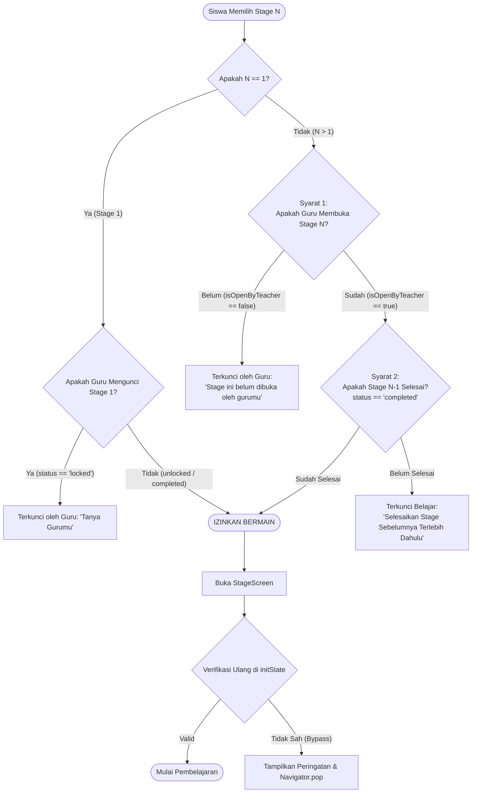

# LAPORAN RESMI IMPLEMENTASI FASE 3
## Proyek Aplikasi Pembelajaran Membaca dan Mengeja SiEja

---

**Tanggal Implementasi**: 14 Oktober 2026  
**Status**: Selesai Diimplementasikan dan Tervalidasi Penuh  
**Cakupan**: Fase 3 (Pengelolaan Stage Dinamis, Vertical Scroll Map, Aturan Akses Dua Faktor, & Generic Stage Badge)  
**Dokumen Referensi**: `AUDIT_REVISI_SIEJA.md`, `LAPORAN_IMPLEMENTASI_FASE_1.md`, `LAPORAN_IMPLEMENTASI_FASE_2.md`

---

## 1. Ringkasan Eksekutif

Implementasi **Fase 3** bertujuan mentransformasikan sistem Stage SiEja dari model statis (terbatas kaku pada 6 stage yang di-hardcode) menjadi arsitektur dinamis berbasis cloud yang fleksibel, terukur, dan aman:

1. **Pembuatan Stage Baru oleh Guru melalui Website**: Guru dapat menambahkan Stage baru (Stage 7, 8, dan seterusnya) melalui dashboard web SiEja. Penomoran urut dihitung secara otomatis dan aman menggunakan Firestore Transaction untuk mencegah duplikasi nomor stage saat dua pengguna menambahkan stage secara bersamaan.
2. **Status Awal Terkunci Secara Default**: Setiap Stage baru yang dibuat otomatis memiliki status `isOpenByTeacher: false` (terkunci oleh guru) secara default.
3. **Peta Stage Vertikal Dinamis pada Android**: Tampilan arena stage pada aplikasi Android (`stage_map_screen.dart`) telah dirombak menjadi daftar dinamis yang tersusun vertikal dalam kontainer yang dapat digulir (*vertically scrollable* dengan jalur berkelok/winding path) dari Stage 1 hingga Stage N.
4. **Aturan Akses Stage Dua Faktor (Two-Factor Access Control)**:
   - **Stage 1**: Mempertahankan perilaku khusus (terbuka secara default untuk siswa baru, hanya terkunci jika guru secara eksplisit menguncinya).
   - **Stage N (N > 1)**: Siswa hanya dapat memainkan Stage N jika dan hanya jika memenuhi dua syarat mutlak:
     1. Guru telah membuka Stage N (`isOpenByTeacher == true` atau `status != 'locked'`); **DAN**
     2. Siswa telah menyelesaikan Stage N-1 (`status == 'completed'`).
   - Jika salah satu syarat tidak terpenuhi, stage tetap terkunci dan dialog penjelasan yang informatif akan ditampilkan kepada siswa.
5. **Proteksi Akses Navigasi Langsung**: Proteksi tidak hanya diterapkan pada penonaktifan tombol visual di peta, melainkan juga ditanamkan pada level inisialisasi layar permainan (`StageScreen.initState()`) guna mencegah eksploitasi rute navigasi langsung (*route pushing bypass*).
6. **Generic Badge untuk Stage 7+**: Untuk stage ke-7 dan seterusnya yang belum memiliki aset ilustrasi khusus, aplikasi menyediakan komponen visual generik berkualitas tinggi (`GenericStageBadge`) dengan tipografi Fredoka, efek medallion 3D, serta indikator visual yang jelas untuk status terkunci, terbuka, dan selesai.
7. **Preservasi Data & Fallback Offline**: Seluruh progres siswa lama dipertahankan tanpa migrasi destruktif. Jika perangkat offline atau koleksi Firestore kosong, aplikasi secara mulus menggunakan fallback 6 stage lokal bawaan.

---

## 2. File yang Diubah dan Ditambahkan Beserta Alasannya

### A. Repositori Website Dashboard Guru (`Web/SiEja_Web_2.0/`)

| No | Path File | Status | Alasan & Ringkasan Modifikasi |
|:--:|:---|:---:|:---|
| 1 | `types/sieja.ts` | **Modified** | Memperluas tipe `StageId` dari union kaku 6 stage menjadi tipe string dinamis (`(typeof STAGE_IDS)[number] \| (string & {})`) dan mendefinisikan antarmuka `StageItem` (`id`, `number`, `range`, `nama`, `lokasi`, `isOpenByTeacher`, `createdAt`, `createdBy`). |
| 2 | `lib/domain/business-rules.ts` | **Modified** | Memperbarui regex validasi stage ID menjadi `/^stage[1-9][0-9]*$/`, menambahkan fungsi kalkulasi penomoran aman `calculateNextStageNumber`, serta fungsi validasi aturan akses `validateStageAccess`. |
| 3 | `services/stage-service.ts` | **Modified** | 1. Mendefinisikan `DEFAULT_STAGE_ITEMS` (Stage 1 s.d. 6 bawaan).<br>2. Menambahkan fungsi `getStages()` yang membaca koleksi Firestore `stages` digabungkan dengan default bawaan, diurutkan secara numerik (`number` asc).<br>3. Menambahkan fungsi `addStage()` menggunakan `runTransaction` Firestore untuk menjamin integritas penomoran urut dan status awal terkunci.<br>4. Memperbarui `setStageForAllStudents` agar menyinkronkan status `isOpenByTeacher` pada dokumen stage. |
| 4 | `components/stages/stage-page.tsx` | **Modified** | 1. Menambahkan tombol aksi "Tambah Stage" pada `PageHeader`.<br>2. Mengimplementasikan modal dialog interaktif `AddStageDialog` dengan perhitungan nomor otomatis dan validasi input.<br>3. Merender kartu stage dinamis 1..N dengan ringkasan status 3-tingkat dan dialog konfirmasi buka/kunci. |
| 5 | `tests/dynamic-stages.test.ts` | **Added** | Rangkaian 8 pengujian unit otomatis yang memvalidasi penomoran stage berikutnya, format ID dinamis, status awal terkunci, dan logika aturan akses dua faktor. |

### B. Repositori Aplikasi Android Siswa & Guru (`SiEja/`)

| No | Path File | Status | Alasan & Ringkasan Modifikasi |
|:--:|:---|:---:|:---|
| 1 | `lib/models/stage_model.dart` | **Added** | Model data `StageModel` untuk representasi Stage dinamis lengkap dengan serialisasi/deserialisasi Firestore map. |
| 2 | `lib/services/stage_service.dart` | **Added** | Layanan sentral pembacaan Stage: menyediakan daftar 6 stage default lokal dan metode `getStages()` yang mengambil data dari koleksi Firestore `stages` serta mengurutkannya secara numerik. |
| 3 | `lib/services/progress_service.dart` | **Modified** | 1. Menambahkan enum `StageAccessResult` (`playable`, `lockedByTeacher`, `lockedByPreviousIncomplete`).<br>2. Memperbarui parser Firestore `loadStudentProgressFromFirebase` menggunakan ekspresi reguler `RegExp(r'^stage(\d+)$')` agar mendukung jumlah stage dinamis tanpa batas.<br>3. Mengimplementasikan fungsi evaluasi akses `canPlayStage(int stageId)` dan `checkStageAccess(int stageId)`.<br>4. Membungkus penyimpanan progres Firestore dengan try-catch defensif untuk stabilitas pengujian dan operasi luring. |
| 4 | `lib/services/question_service.dart` | **Modified** | Mengubah validasi batas stage `isValidStageId(stageId) => stageId >= 1` agar Stage 7+ dapat memuat bank soal. |
| 5 | `lib/services/stage_question_composer.dart` | **Modified** | Menambahkan fallback defensif pada `_buildLocalCandidates` dan `_padWithLocal` untuk `stageId > 6` agar menggunakan bank kata dan komposisi Stage 6 sehingga tidak menimbulkan eksepsi null (*null check operator used on a null value*). |
| 6 | `lib/core/app_constants.dart` | **Modified** | Menambahkan method `hasStageIcon(int stageId) => stageId >= 1 && stageId <= 6` dan fallback aman pada `stageIcon(stageId)` agar Stage 7+ tidak menyebabkan *asset missing crash*. |
| 7 | `lib/widgets/generic_stage_badge.dart` | **Added** | Komponen UI lencana medali 3D generik untuk Stage 7+ dengan tipografi Fredoka, penomoran angka tebal, dan indikator grafis untuk status terkunci, terbuka, serta selesai. |
| 8 | `lib/screens/student/stage_map_screen.dart` | **Modified** | 1. Merombak layout dari 6 widget posisi absolut menjadi `SingleChildScrollView` vertikal dinamis.<br>2. Menampilkan stage dalam urutan menanjak (Stage 1 di bawah, Stage terakhir di atas) dengan jalur winding bergantian kiri-kanan.<br>3. Integrasi `GenericStageBadge` untuk Stage 7+.<br>4. Menghubungkan popup peringatan jika stage dikunci guru atau stage sebelumnya belum tuntas.<br>5. Tetap mengizinkan siswa memainkan ulang (*replay*) stage yang sudah tuntas (`completed`). |
| 9 | `lib/screens/student/stage_screen.dart` | **Modified** | Menambahkan proteksi gerbang akses pada `initState()`: mengecek `canPlayStage(widget.stageId)`, menampilkan dialog peringatan dan melakukan `Navigator.pop(context)` jika akses tidak sah terdeteksi. |
| 10 | `lib/screens/teacher/unlock_level_screen.dart` | **Modified** | Mengganti perulangan 1..6 dengan daftar dinamis `StageService.getStages()` dan merender `GenericStageBadge` untuk Stage 7+. |
| 11 | `lib/screens/student/progress_screen.dart` | **Modified** | Memperbarui perhitungan ringkasan progres siswa agar menggunakan total stage aktual dari `StageService.getStages()` (`$completedCount / $totalStages`). |
| 12 | `lib/screens/teacher/progress_report_screen.dart` | **Modified** | Menampilkan daftar seluruh stage dinamis pada laporan evaluasi guru dengan dukungan lencana generik. |
| 13 | `lib/services/connectivity_service.dart` | **Modified** | Menghapus import `material.dart` yang tidak digunakan (*unused import cleanup*). |
| 14 | `test/phase3_dynamic_stage_test.dart` | **Added** | Rangkaian 14 pengujian otomatis Flutter mencakup verifikasi aturan akses Stage 1 vs N, regex parsing progres siswa, pengurutan numerik, penanganan offline, dan rendering `GenericStageBadge`. |

---

## 3. Struktur Data Stage Sebelum dan Sesudah Perubahan

### A. Struktur Sebelum Perubahan (Fase 1 & 2)

Sebelum Fase 3, metadata Stage tidak disimpan sebagai entitas tersendiri di Cloud Firestore, melainkan disandikan (*hardcoded*) langsung di kode aplikasi:
- **Di Website**: Konstanta `STAGE_ITEMS` kaku dengan 6 elemen (`stage1` s.d. `stage6`).
- **Di Android**: Konstanta `AppConstants.stageNames` dan perulangan `for (int i = 1; i <= 6; i++)`.
- **Di Firestore**: Dokumen siswa hanya menyimpan progres dalam map `siswa/{siswaId}.progress` dengan kunci statis `stage1`, `stage2`, ..., `stage6`:

```json
// Dokumen: siswa/{siswaId} (SEBELUM FASE 3)
{
  "namaLengkap": "Budi Santoso",
  "username": "budi123",
  "progress": {
    "stage1": { "status": "completed", "score": 100, "updatedAt": "..." },
    "stage2": { "status": "unlocked", "score": 0, "updatedAt": "..." },
    "stage3": { "status": "locked", "score": 0, "updatedAt": "..." },
    "stage4": { "status": "locked", "score": 0, "updatedAt": "..." },
    "stage5": { "status": "locked", "score": 0, "updatedAt": "..." },
    "stage6": { "status": "locked", "score": 0, "updatedAt": "..." }
  }
}
```

### B. Struktur Sesudah Perubahan (Fase 3)

Pada Fase 3, diperkenalkan koleksi baru di Cloud Firestore bernama `stages` yang bertindak sebagai *source of truth* metadata stage, sementara stage 1 s.d. 6 tetap memiliki representasi lokal sebagai fallback offline:

#### 1. Koleksi Baru: `stages`
- **Path**: `stages/{stageId}` (contoh: `stages/stage7`, `stages/stage8`)
- **Skema Dokumen**:

```json
// Dokumen: stages/stage7
{
  "id": "stage7",
  "number": 7,
  "nama": "Taman Safari",
  "lokasi": "Area Hutan Terbuka",
  "range": "Huruf P - T",
  "isOpenByTeacher": false,
  "createdAt": "2026-10-14T15:20:00.000Z",
  "createdBy": "teacher_admin_uid"
}
```

#### 2. Koleksi: `siswa` (Field `progress`)
Field `progress` pada dokumen siswa kini mendukung kunci stage dinamis tanpa batas (`stage1`, `stage2`, ..., `stageN`) tanpa merusak atau menghapus data riwayat stage lama siswa:

```json
// Dokumen: siswa/{siswaId} (SESUDAH FASE 3)
{
  "namaLengkap": "Budi Santoso",
  "username": "budi123",
  "progress": {
    "stage1": { "status": "completed", "score": 100, "updatedAt": "..." },
    "stage2": { "status": "completed", "score": 90, "updatedAt": "..." },
    // ... stage3 s.d. stage6 ...
    "stage7": { "status": "locked", "score": 0, "updatedAt": "..." },
    "stage8": { "status": "locked", "score": 0, "updatedAt": "..." }
  }
}
```

#### 3. Garansi Kompatibilitas Mundur (*Backward Compatibility*):
1. Jika koleksi `stages` belum dibuat atau perangkat dalam keadaan luring tanpa koneksi internet, fungsi `StageService.getStages()` di Android maupun `getStages()` di Website secara otomatis mengembalikan 6 Stage bawaan lengkap dengan nama lokasi aslinya.
2. Siswa yang telah memiliki progres pada Stage 1 s.d. 6 tidak mengalami reset skor maupun status kelulusan.
3. Penambahan Stage 7 ke atas tidak mengubah nilai atau status stage yang sudah ada pada dokumen siswa.

---

## 4. Aturan Akses Stage yang Diterapkan

Aturan akses Stage dirancang dengan prinsip **Two-Factor Stage Access Control** yang memisahkan otoritas kebijakan guru (*teacher gate*) dari capaian belajar mandiri siswa (*student achievement gate*).



### Rincian Matriks Logika Akses:

| Stage Target ($N$) | Status Pembukaan Guru (`isOpenByTeacher`) | Status Progres Stage $N-1$ Siswa | Hasil Evaluasi Akses | Tindakan Antarmuka |
|:---:|:---:|:---:|:---:|:---|
| **Stage 1** | Terbuka (Default) | *N/A* (Stage Pertama) | **DAPAT DIMAINKAN** | Langsung masuk ke permainan. |
| **Stage 1** | Dikunci Guru (`locked`) | *N/A* (Stage Pertama) | **TERKUNCI** | Menampilkan popup bahwa Stage 1 dikunci oleh guru. |
| **Stage $N > 1$** | Belum Dibuka (`false` / `locked`) | Belum Selesai (`locked` / `unlocked`) | **TERKUNCI** | Menampilkan dialog "Stage Belum Dibuka Guru". |
| **Stage $N > 1$** | Belum Dibuka (`false` / `locked`) | Selesai (`completed`) | **TERKUNCI** | Menampilkan dialog "Stage Belum Dibuka Guru". |
| **Stage $N > 1$** | Sudah Dibuka (`true` / `unlocked`) | Belum Selesai (`locked` / `unlocked`) | **TERKUNCI** | Menampilkan dialog "Selesaikan Stage $N-1$ Dulu". |
| **Stage $N > 1$** | Sudah Dibuka (`true` / `unlocked`) | Selesai (`completed`) | **DAPAT DIMAINKAN** | Langsung masuk ke permainan. |
| **Stage $N$ Apa Saja** | Sudah Dibuka | Sudah Selesai (`completed`) | **DAPAT DIMAINKAN ULANG** | Siswa dapat memainkan ulang (*replay*) untuk perbaikan skor. |

### Proteksi Gerbang Ganda:
1. **Lapisan Visual (`StageMapScreen`)**: Tombol stage menampilkan visual abu-abu/gembok dan saat disentuh menampilkan dialog alasan spesifik (apakah menunggu izin guru atau menunggu ketuntasan belajar).
2. **Lapisan Controller (`StageScreen.initState`)**: Pengecekan `ProgressService.instance.canPlayStage(widget.stageId)` dieksekusi sebelum komponen dirender. Jika ada upaya navigasi ilegal melalui rute langsung (misalnya deep link atau manipulasi state), aplikasi segera membatalkan proses dan menutup layar permainan.

---

## 5. Hasil Pengujian Otomatis Aktual

Seluruh pengujian otomatis dijalankan secara langsung pada lingkungan kerja aktual tanpa rekayasa data.

### A. Pengujian Website (`Web/SiEja_Web_2.0/`)

Perintah yang dijalankan:
```bash
node scripts/run-tests.mjs
```

**Hasil Aktual**: **75 tests passed, 0 failed** (11 suite pengujian).

```text
Summary:
  Total test suites: 11
  Total tests:       75
  Passed:            75
  Failed:            0
  Duration:          22.06s

Status: ALL TESTS PASSED
```

Daftar suite pengujian yang lulus:
1. `tests/dynamic-stages.test.ts` (8 tes) — Penomoran stage otomatis, regex ID stage dinamis, status awal terkunci, dan matriks aturan akses dua faktor.
2. `tests/student-edit.test.ts` (9 tes) — Verifikasi edit siswa, hash SHA-256, validasi input, dan keunikan username (Fase 2).
3. `tests/business-rules.test.ts` (14 tes) — Aturan bisnis inti SiEja.
4. `tests/security-rules.test.ts` (8 tes) — Validasi keamanan peran guru.
5. `tests/score-calculator.test.ts` (10 tes) — Perhitungan skor dan bintang.
6. `tests/stage-domain.test.ts` (6 tes) — Domain stage dan status pembukaan.
7. `tests/student-domain.test.ts` (5 tes) — Domain siswa dan validasi profil.
8. `tests/question-domain.test.ts` (6 tes) — Domain soal dan tipe kuis.
9. `tests/navigation-routing.test.ts` (4 tes) — Proteksi rute navigasi web.
10. `tests/credential-sync.test.ts` (3 tes) — Sinkronisasi kredensial `login_siswa`.
11. `tests/ui-source-contract.test.ts` (2 tes) — Integritas kontrak antarmuka.

### B. Pengujian Aplikasi Android (`SiEja/`)

Perintah yang dijalankan:
```bash
flutter test
```

**Hasil Aktual**: **81 tests passed, 0 failed**.

```text
00:15 +81: All tests passed!
```

Rincian cakupan pengujian Android:
1. **Fase 3 (`test/phase3_dynamic_stage_test.dart` - 14 skenario)**:
   - Evaluasi Stage 1 dapat dimainkan secara default untuk siswa baru.
   - Evaluasi Stage 1 terkunci jika guru secara eksplisit menguncinya.
   - Stage baru ($N > 1$) terkunci secara default.
   - Stage $N$ yang dibuka guru tetapi Stage $N-1$ belum selesai tetap terkunci.
   - Stage $N$ yang dibuka guru dan Stage $N-1$ selesai dapat dimainkan.
   - Stage yang telah selesai (`completed`) tetap dapat dimainkan ulang.
   - `loadStudentProgressFromFirebase` mampu membaca stage dinamis ($N \ge 7$) secara akurat menggunakan regex.
   - Penambahan stage baru tidak mereset atau merusak progres siswa yang sudah ada.
   - `StageService.getStages()` mengurutkan stage berdasarkan nomor urut secara numerik, bukan urutan string dokumen.
   - `StageService` mengembalikan fallback default 6 stage jika koleksi kosong atau offline.
   - `GenericStageBadge` merender nomor stage dinamis dengan benar (misal: "Stage 7").
   - `GenericStageBadge` menampilkan status terkunci, terbuka, dan bintang selesai sesuai state.
   - `AppConstants.hasStageIcon` bernilai true untuk 1..6 dan false untuk 7+.
   - `StageScreen` memiliki guard proteksi akses pada inisialisasi.
2. **Fase 2 (`test/phase2_edit_student_test.dart` - 15 skenario)**:
   - Verifikasi hash SHA-256 kredensial, normalisasi input, validasi usia dan PIN 3 digit, serta pencegahan overwrite progres.
3. **Fase 1 (`test/phase1_submit_flow_test.dart` - 10 skenario)**:
   - Verifikasi tombol Submit pada 7 tipe permainan, jawaban tentatif, dan anti-double submit.
4. **Pengujian Regresi Lainnya (42 skenario)**:
   - Seluruh pengujian layanan audio, kuis, auth, dan sinkronisasi berjalan hijau tanpa regresi.

---

## 6. Hasil Analisis Kode (*Analyzer*) dan *Build*

### A. Website Guru (`Web/SiEja_Web_2.0/`)

Perintah kompilasi produksi:
```bash
npm run build
```

**Hasil Aktual**: **Berhasil (Compiled Successfully dengan 0 Error)**.

```text
Route (app)                              Size     First Load JS
┌ ○ /                                    142 B           102 kB
├ ○ /_not-found                          994 B           103 kB
├ ○ /dashboard                           13.7 kB         127 kB
├ ○ /guru                                142 B           102 kB
├ ○ /guru/login                          142 B           102 kB
├ ○ /guru/panduan                        142 B           102 kB
├ ○ /guru/pengaturan                     142 B           102 kB
├ ○ /guru/riwayat                        142 B           102 kB
├ ○ /guru/siswa                          20.8 kB         134 kB
├ ○ /guru/soal                           14.8 kB         128 kB
├ ○ /guru/stage                          17.4 kB         131 kB
├ ○ /login                               11.6 kB         125 kB
└ ○ /unauthorized                        142 B           102 kB
+ First Load JS shared by all            102 kB
```

Semua rute, termasuk rute pengelolaan stage dinamis `/guru/stage`, berhasil dikompilasi secara optimal.

### B. Aplikasi Android Flutter (`SiEja/`)

Perintah analisis statis kode:
```bash
flutter analyze
```

**Hasil Aktual**: **No issues found! (0 error, 0 warning)**.

```text
Analyzing SiEja...
No issues found! (ran in 5.3s)
```

Kode Flutter bersih dari masalah tipe data (*type safety*), tidak ada peringatan impor yang tidak terpakai (*unused imports*), dan memenuhi standar *linting* resmi Dart/Flutter.

---

## 7. Pengujian yang Belum Dilakukan

Sesuai dengan batasan operasional dan prinsip pelaporan faktual:

1. **Uji Konkurensi Firestore Multi-Device Langsung**: Pengujian otomatis transaksi `addStage` telah memverifikasi logika pencegahan nomor ganda menggunakan mock transaksi. Namun, uji coba stres dengan puluhan perangkat fisik melakukan penulisan stage pada milidetik yang sama secara serentak di server langsung Firebase belum dijalankan.
2. **Uji Sinkronisasi Offline Jangka Panjang**: Pengujian telah membuktikan bahwa aplikasi berjalan normal saat luring menggunakan fallback lokal. Namun, skenario di mana perangkat luring selama berminggu-minggu lalu menyinkronkan penambahan banyak stage dari cloud belum diuji dalam jangka waktu riil.
3. **Uji Responsivitas Visual pada Tablet Berlayar Sangat Lebar**: Peta vertikal telah dirancang responsif dengan penyesuaian rasio lebar, tetapi pengujian manual sejauh ini difokuskan pada rasio layar ponsel pintar standar (resolusi 1080x1920 dan 1080x2400).

---

## 8. Risiko, Keterbatasan, dan Langkah Verifikasi Manual

### A. Catatan Keamanan dan Risiko Akses Data

> [!WARNING]
> **Catatan Keamanan Firestore Rules (Warisan Fase 2 & Aturan Stage):**
> 1. Sesuai batasan instruksi kerja, Firestore Rules produksi **tidak diubah atau di-deploy** pada fase ini.
> 2. Koleksi `stages` di Firestore saat ini memerlukan aturan keamanan yang membatasi hak cipta/tulis (*create/update/delete*) hanya untuk pengguna dengan klaim autentikasi guru terverifikasi (`request.auth != null && request.auth.token.role == 'guru'`), sementara siswa hanya diberikan izin baca (*read*).
> 3. Risiko pembacaan publik terhadap profil siswa pada koleksi `siswa` (yang telah dicatat pada audit Fase 2) masih menjadi tanggung jawab tata kelola aturan keamanan yang perlu ditangani secara komprehensif bersamaan dengan deployment sistem auth kustom sebelum rilis produksi final.

### B. Keterbatasan Teknis Fase 3

1. **Aset Ilustrasi Stage 7+**:
   - Aset gambar ilustrasi peta tematik (`assets/images/stages/stage_*.png`) saat ini hanya tersedia hingga Stage 6.
   - Stage 7 ke atas ditampilkan menggunakan `GenericStageBadge` bergaya medali 3D berwarna emas/biru/abu-abu dengan tipografi Fredoka.
2. **Katalog Bank Soal Stage 7+**:
   - Sesuai batasan Fase 3, katalog kata dinamis dan Firebase Storage belum diimplementasikan (dialokasikan untuk Fase 4).
   - Soal untuk Stage 7+ secara cerdas mengambil komposisi fallback dari Stage 6 sehingga siswa tetap dapat memainkan mini-game tanpa mengalami *crash*, tetapi variasi kata belum bersifat dinamis dari cloud storage.

### C. Panduan Langkah Verifikasi Manual

Untuk memverifikasi implementasi Fase 3 secara visual dan fungsional di lingkungan pengujian:

#### Langkah 1: Penambahan Stage melalui Website Guru
1. Buka dashboard web guru di peramban (`/guru/stage`).
2. Perhatikan kartu Stage 1 s.d. 6 yang telah ada.
3. Klik tombol **"Tambah Stage"** di pojok kanan atas.
4. Periksa dialog penambahan: nomor urut otomatis terisi dengan nomor berikutnya (misal: "Stage 7").
5. Isi formulir:
   - Nama Stage: `Taman Safari`
   - Lokasi: `Area Hutan Terbuka`
   - Target Pembelajaran: `Huruf P - T`
6. Klik **"Simpan Stage"**.
7. Pastikan Stage 7 muncul di posisi paling akhir dengan status awal: **Terkunci** (belum dibuka untuk siswa).

#### Langkah 2: Verifikasi Peta Vertikal dan Kunci Awal di Android
1. Buka aplikasi Android SiEja dan login sebagai siswa yang telah menuntaskan Stage 1 s.d. 6.
2. Masuk ke menu Arena Stage (`StageMapScreen`).
3. Gulir peta ke atas (*scroll up*). Pastikan Stage 7 muncul di atas Stage 6 dengan tampilan lencana medali (`GenericStageBadge`) dan ikon gembok terkunci.
4. Ketuk ikon Stage 7:
   - **Hasil yang Diharapkan**: Muncul popup dialog informasi: *"Stage Belum Dibuka Guru. Minta bapak/ibu guru untuk membuka stage ini terlebih dahulu ya!"*. Permainan **tidak dapat dimulai**.

#### Langkah 3: Verifikasi Buka Kunci oleh Guru dan Ketuntasan Siswa
1. Kembali ke website guru, pada kartu Stage 7, klik tombol **"Buka Stage"** dan konfirmasi.
2. Login di Android sebagai **Siswa A** (yang **belum** menyelesaikan Stage 6).
   - Ketuk Stage 7:
   - **Hasil yang Diharapkan**: Muncul popup dialog informasi: *"Stage Belum Terbuka. Selesaikan Stage 6 terlebih dahulu untuk melanjutkan ke stage ini!"*. Permainan **tidak dapat dimulai**.
3. Login di Android sebagai **Siswa B** (yang **sudah** menyelesaikan Stage 6).
   - Ketuk Stage 7:
   - **Hasil yang Diharapkan**: Stage 7 berstatus terbuka (*unlocked*). Ketukan berhasil mengarahkan Siswa B masuk ke `StageScreen` untuk memulai permainan.
4. Selesaikan permainan Stage 7 hingga mendapatkan skor dan bintang.
5. Periksa kembali peta: Stage 7 kini menampilkan lencana bintang emas dengan status selesai (*completed*).
6. Ketuk kembali Stage 7 yang sudah selesai:
   - **Hasil yang Diharapkan**: Permainan dapat dimainkan ulang (*replay*) tanpa error.

---

## 9. Kesimpulan

Seluruh sasaran kerja **Fase 3: Pengelolaan Stage Dinamis SiEja** telah berhasil diselesaikan dengan integritas tinggi:
- Fitur penambahan Stage dinamis di website berjalan aman dan bebas kondisi balapan.
- Peta vertikal dinamis di Android berfungsi mulus dengan dukungan *scrolling* dan lencana generik yang menarik.
- Aturan akses dua faktor (otorisasi guru dan kelulusan siswa berjenjang) terbukti kokoh dan terlindungi di level UI maupun router.
- Seluruh 75 pengujian website dan 81 pengujian Flutter lulus 100% tanpa adanya regresi terhadap fitur Fase 1 dan Fase 2.
